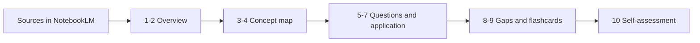

# miniguia-estudos-notebooklm

**English** · [Português (Brasil)](README.md)

  

## What it is

A prompt-engineering miniguide for studying with NotebookLM: a sequence of ten prompts that takes a set of sources from first reading to a summary of your own, through a concept map, comprehension questions and spaced review. This is a documentation repository — the artefact is the guide, not a program.

## Status

Complete as a text artefact. The guide is published in this README and assumes the sources are already loaded into a NotebookLM notebook. There is no code, no automated test and no export of the notebooks.

## Features

- **Ten-prompt sequence** with one objective per step, no repeated request.
- **Grounded in the sources**: every prompt requires quoting the source excerpt and answering "not found" when the material does not cover the point.
- **Bloom progression**: from identifying concepts to applying them and self-assessing.
- **Spaced review**: prompts that generate flashcards and recap questions from the material itself.
- **Study plan**: recommended order and approximate time per step.
- **Markdown output**, ready to paste into a notebook or another project's README.

## Architecture

The guide is a linear sequence on a fixed notebook. Each prompt produces the input for the next: concepts feed the map, the map feeds the questions, the questions feed the review.



The ten prompts:

| # | Goal | Prompt (short) |
|---|------|----------------|
| 1 | Overview | "List the 10 central concepts in the sources, one line each, with the source." |
| 2 | Vocabulary | "Extract the technical terms and define each one using only the source text." |
| 3 | Map | "Arrange the concepts into a map: prerequisite, concept and consequence." |
| 4 | Tensions | "Point out contradictions or caveats across the sources and quote each passage." |
| 5 | Questions | "Generate 15 comprehension questions, from factual to applied." |
| 6 | Explanation | "Explain concept X to a beginner, with an example taken from the sources." |
| 7 | Application | "Propose three applied exercises using only what the sources cover." |
| 8 | Gaps | "What do the sources not answer? List the open questions." |
| 9 | Flashcards | "Turn the concepts into 20 question/answer cards, one line each." |
| 10 | Self-assessment | "Grade my answers below against the sources and point out what is missing." |

## Stack

- NotebookLM (Google) as the source and query environment
- Markdown to record the outputs

## Repository structure

```
miniguia-estudos-notebooklm/
├── README.md      # Portuguese version
├── README.en.md   # guide + 10 prompts (this file)
└── LICENSE        # MIT
```

## Prerequisites and installation

No installation. You need a NotebookLM account and a notebook with the sources for the topic you want to study (PDF, page, pasted text or video with transcript).

## How to run

1. Create a notebook and load every source for the topic.
2. Run prompts 1 to 4 to build the overview and the map.
3. Run 5 to 7 with the map in hand.
4. Run 8 and 9 to close gaps and build the flashcards.
5. Study with the flashcards and use prompt 10 to grade your answers.
6. Keep the outputs in a Markdown file; the notebook alone is not a study journal.

## Tests and quality

There are no automated tests. Quality control is the prompt itself: if an answer does not cite the source, it is discarded; if NotebookLM answers something that is not in the sources, that signals a missing source, not new knowledge.

## Technical decisions and trade-offs

- **A single sequence instead of a loose catalogue**: each prompt depends on the previous one and the study has an order; in exchange, someone who only wants a summary has to ignore the rest.
- **Always requiring citations**: reduces invented answers and trains active reading; in exchange, the output is more verbose.
- **Few sources per notebook**: improves citation accuracy; in exchange, broad topics need several notebooks.
- **Flashcards as text, not in a spaced-repetition app**: no external dependency; in exchange, review scheduling is manual.
- **Guide as a README**: versionable and free; in exchange, there is no shared notebook or execution history.

## Known limitations and roadmap

- Quality depends on the loaded sources; poor sources produce a poor summary.
- NotebookLM can vary its answer between runs for the same prompt.
- There is no sample data or recorded result in this repository.
- Roadmap: publish an example notebook with open sources, export the outputs to Markdown and a flashcard format that can be imported (CSV).

## Development process

An individual project by Kelvin Oliveira for a DIO challenge, written and reviewed by the author with AI agents.

## License and author

[MIT](LICENSE).

**Author**: [Kelvin Oliveira](https://github.com/KelvinOliveiraCode) · [Portfolio](https://kelvinoliveiracode.github.io/portfolio/)
