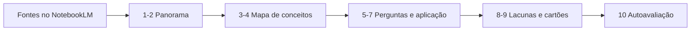

# miniguia-estudos-notebooklm

[English](README.en.md) · **Português (Brasil)**

  

## O que é

Miniguia de engenharia de prompts para estudar com o NotebookLM: uma sequência de dez prompts que leva um conjunto de fontes de uma leitura inicial até um resumo próprio, passando por mapa de conceitos, perguntas de verificação e revisão espaçada. O repositório é de documentação — o artefato é o guia, não um programa.

## Status

Concluído como artefato de texto. O guia está publicado neste README e pressupõe que as fontes já foram carregadas em um notebook do NotebookLM. Não há código, teste automatizado nem exportação dos notebooks.

## Funcionalidades

- **Sequência de dez prompts** com um objetivo por etapa, sem repetir pedido.
- **Aterramento nas fontes**: todo prompt exige citação do trecho de origem e resposta "não encontrado" quando o material não cobre o ponto.
- **Progressão de Bloom**: da identificação de conceitos à aplicação e à autoavaliação.
- **Revisão espaçada**: prompts que geram cartões e perguntas de recapitulação a partir do próprio material.
- **Roteiro de estudo**: ordem recomendada e tempo aproximado por etapa.
- **Formato de saída em Markdown**, pronto para colar em um caderno ou no README de outro projeto.

## Arquitetura

O guia é uma sequência linear sobre um notebook fixo. Cada prompt produz um insumo do próximo: conceitos alimentam o mapa, o mapa alimenta as perguntas, as perguntas alimentam a revisão.



Os dez prompts:

| # | Objetivo | Prompt (curto) |
|---|----------|----------------|
| 1 | Panorama | "Liste os 10 conceitos centrais das fontes, com uma linha cada e a fonte." |
| 2 | Vocabulário | "Extraia os termos técnicos e defina cada um usando apenas o texto das fontes." |
| 3 | Mapa | "Organize os conceitos em um mapa: pré-requisito, conceito e consequência." |
| 4 | Tensões | "Aponte contradições ou ressalvas entre as fontes e cite cada trecho." |
| 5 | Perguntas | "Gere 15 perguntas de compreensão, das factuais às de aplicação." |
| 6 | Explicação | "Explique o conceito X para um iniciante, com um exemplo tirado das fontes." |
| 7 | Aplicação | "Proponha três exercícios aplicados usando só o que as fontes cobrem." |
| 8 | Lacunas | "O que as fontes não respondem? Liste perguntas em aberto." |
| 9 | Cartões | "Transforme os conceitos em 20 cartões pergunta/resposta, uma linha cada." |
| 10 | Autoavaliação | "Corrija minhas respostas abaixo com base nas fontes e aponte o que faltou." |

## Stack

- NotebookLM (Google) como ambiente de fontes e consulta
- Markdown para registrar as saídas

## Estrutura do repositório

```
miniguia-estudos-notebooklm/
├── README.md      # guia + 10 prompts (pt-BR)
├── README.en.md   # versão em inglês
└── LICENSE        # MIT
```

## Pré-requisitos e instalação

Nenhuma instalação. É preciso uma conta no NotebookLM e um notebook com as fontes do tema que se quer estudar (PDF, página, texto colado ou vídeo com transcrição).

## Como executar

1. Crie um notebook e carregue todas as fontes do tema.
2. Rode os prompts 1 a 4 para construir o panorama e o mapa.
3. Rode 5 a 7 com o mapa em mãos.
4. Rode 8 e 9 para fechar lacunas e montar os cartões.
5. Estude pelos cartões e use o prompt 10 para corrigir as respostas.
6. Guarde as saídas em um arquivo Markdown; o notebook sozinho não é um caderno de estudo.

## Testes e qualidade

Não há testes automatizados. O controle de qualidade é o próprio prompt: se a resposta não citar a fonte, ela é descartada; se o NotebookLM responder algo que não está nas fontes, isso indica fonte faltando, não conhecimento novo.

## Decisões técnicas e trade-offs

- **Sequência única em vez de catálogo solto**: cada prompt depende do anterior e o estudo tem ordem; em troca, quem quer só um resumo precisa ignorar o restante.
- **Exigir citação sempre**: reduz resposta inventada e treina leitura ativa; em troca, deixa a saída mais verbosa.
- **Poucas fontes por notebook**: melhora a precisão das citações; em troca, temas amplos exigem vários notebooks.
- **Cartões em texto, não em app de repetição espaçada**: sem dependência externa; em troca, o agendamento da revisão fica manual.
- **Guia em README**: versionável e gratuito; em troca, não há notebook compartilhado nem histórico de execução.

## Limitações conhecidas e roadmap

- A qualidade depende das fontes carregadas; fonte ruim gera resumo ruim.
- O NotebookLM pode variar a resposta entre execuções para o mesmo prompt.
- Não há dados de exemplo nem resultados registrados neste repositório.
- Roadmap: publicar um notebook de exemplo com fontes abertas, exportar as saídas em Markdown e um formato de cartões importável (CSV).

## Processo de desenvolvimento

Projeto individual de Kelvin Oliveira para um desafio da DIO, escrito e revisado pelo autor com apoio de agentes de IA.

## Licença e autor

[MIT](LICENSE).

**Autor**: [Kelvin Oliveira](https://github.com/KelvinOliveiraCode) · [Portfólio](https://kelvinoliveiracode.github.io/portfolio/)
